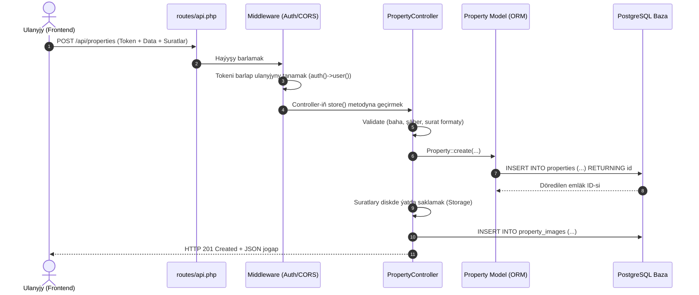
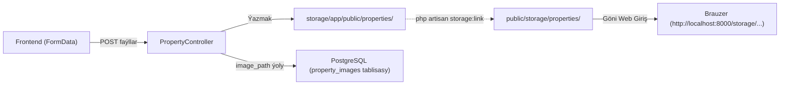

# EmläkGO Backend — Çuňňur Tehniki Düşündiriş (Deep Dive)

Bu resminama **EmläkGO** taslamasynyň backend ulgamynyň içki mehanizmlerini, kodyň serwerde nähili aýlanýandygyny we maglumatlaryň ädimme-ädim nähili işlenýändigini çuňňur düşündirýär.

---

## 1. Bir Haýyşyň (HTTP Request) Ömrü: Ädimme-ädim

Frontend-de ulanyjy bir düwmä basan pursadyndan tä ekranda netijäni görýänçä serwerde nämeler bolup geçýär?



### Ädimleriň Jikme-jikligi:
1. **Haýyşyň ugradylmagy:** Brauzer serwere `POST` haýyşyny ugradýar. Haýyşyň kellesinde (`Headers`) `Authorization: Bearer <token>`, bedeninde (`Body`) bolsa jaýyň maglumatlary we suratlary bolýar.
2. **Giriş nokady (`public/index.php`):** Laravel taslamasyna gelen ähli haýyşlar ilki `index.php` faýlyna düşýär. Bu ýerde tutuş freýmwork (service provider-lar, konfigurasiýalar) ýatda işe girizilýär.
3. **Middleware (Gözegçiler):** 
   - `CorsMiddleware`: Başga portdan (meselem localhost:5173-den) gelen haýyşlara rugsat berýär.
   - `AuthMiddleware`: Tokeni barlap, ulanyjynyň kimdigini anyklaýar. Eger token ýalňyş bolsa, işi derrew togtadyp `401 Unauthorized` gaýtarýar.
4. **Routing (`routes/api.php`):** Gelen URL-e görä haýsy Controller-iň haýsy funksiýasyny çagyrjagyny kesgitleýär.
5. **Controller & Validation:** 
   - Gelýän maglumatlaryň dogrulygyny barlaýar: baha sanmy? Şäher saýlandymy? Surat barmy?
   - Eger kemçilik bolsa, `422 Unprocessable Entity` ýalňyşlygyny berýär.
6. **Eloquent ORM & PostgreSQL:** Model arkaly arassa SQL emele getirilýär we PostgreSQL bazasynda tranzaksiýa ýerine ýetirilýär.
7. **JSON Formatdaky Jogap:** Maglumat bazadan alnyp, obýekt görnüşinden JSON tekstine öwrülýär we brauzere ugradylýar.

---

## 2. Autentifikasiýa (Giriş & Hasaba Alyş) Nähili Işleýär?

### A. Hasaba alyş (Register)
1. Ulanyjy parolyny ýazanda (meselem `parol123`), backend ony hiç wagt göni şol durşuna bazada saklamaýar.
2. **Bcrypt Kriptografiýasy:** Laravel `Hash::make('parol123')` funksiýasy arkaly bu söze random duz (`salt`) goşup, birugurly uzyn heş koda öwürýär:
   `$2y$12$e8Y7aN21QJk6nFq9z8u.VO9pZ1XG2k5L8o0bC4m3a1z2...`
3. Bu heş kody yzyna açyp (deşifrirläp) bolmaýar.

### B. Giriş etmek (Login) we Token Döretmek
1. Ulanyjy email we paroly girizýär.
2. Backend bazadan şol email-e degişli ulanyjyny tapýar.
3. `Hash::check($parol, $ulanyjy->password)` arkaly girizilen parolyň heşi bilen bazadaky heşi deňeşdirýär.
4. Eger dogry bolsa, unikal gizlin **API Token** döredilýär (meselem `64|d8f1e2a3c4...`).
5. Frontend bu tokeni alyp, özünde `localStorage`-da saklaýar.
6. Indiki gezek ulanyjy islän sahypasyna girende, bu token awtomatiki kellesine (`Header`) ýazylyp ugradylýar. Şeýlelikde serwer her gezek paroly sorap durman, diňe token arkaly ulanyjyny derrew tanaýar.

---

## 3. Maglumat Bazasy we Gatnaşyklar (Eloquent Relationships)

Laravel-iň iň güýçli tarapy — **Eloquent ORM** (Object-Relational Mapping). Biz çylşyrymly SQL ýazman, PHP obýektleri arkaly bazany dolandyrýarys.

### Esasy Gatnaşyklar:

| Gatnaşyk | PHP Kody | Düşündirişi |
|---|---|---|
| **User -> Properties** | `$user->properties()` | Bir ulanyjynyň birnäçe goşan emlägi bolup bilýär (`hasMany`). |
| **Property -> User** | `$property->user` | Her bir emläk diňe bir ulanyja degişlidir (`belongsTo`). |
| **Property -> Category** | `$property->category` | Her bir emläk bir kategoriýa degişlidir (`belongsTo`). |
| **Property -> Images** | `$property->images` | Bir emlägiň köp suraty bolup bilýär (`hasMany`). |
| **Property -> Comments** | `$property->comments()` | Bir emläkde köp teswir bolup bilýär (`hasMany`). |
| **Comment -> Replies** | `$comment->replies()` | Bir teswiriň aşagynda köp jogap bolup bilýär (Self-referencing `hasMany`). |
| **User <-> Favorites** | `$user->favoriteProperties()` | Köpden-köpe (`belongsToMany`) gatnaşyk. |

### Mysal: "Eager Loading" bilen N+1 Problemasynyň Çözülişi
Eger 20 sany jaýy görkezjek bolsak we her jaýyň eýesini aýratyn çagyrsak, baza 21 gezek SQL sorag ugradylar (bu ulgamy haýalladýar).  
Biz Laravel-de **Eager Loading** ulandyk:
```php
$properties = Property::with(['category', 'primaryImage', 'user'])->paginate(12);
```
Bu kod 21 sany SQL-iň deregine diňe **3 sany optimal SQL** ugradyp, ähli maglumaty derrew ýada ýükleýär.

---

## 4. Surat Ýüklemek we Storage Symlink Mehanizmi

Suratlary göni PostgreSQL bazasynda (BLOB görnüşinde) saklamak uly ýalňyşlykdyr, sebäbi baza çalt ulalyp gaty haýal işleýär.



1. **Suratyň gelmegi:** Ulanyjy 3-4 sany surat saýlanda, frontend muny `multipart/form-data` görnüşinde ugradýar.
2. **Unikal at:** `$file->hashName()` arkaly surata unikal şifrli at berilýär (meselem: `f8d93c12a.jpg`). Bu iki ulanyjy meňzeş atly surat ýüklese-de biri-biriniň üstüne ýazylmazlygyny üpjün edýär.
3. **Diske ýazylmagy:** Surat `storage/app/public/properties` papkasynda fiziki faýl edilip ýazylýar.
4. **Storage Symlink:** Web serwer howpsuzlyk sebäpli `storage/` papkasyna göni girişe rugsat bermeýär. Şonuň üçin `php artisan storage:link` komandasy arkaly `public/storage` papkasyndan `storage/app/public`-e wirtual köpri (symlink) guruldy. Netijede brauzer `http://localhost:8000/storage/properties/f8d93c12a.jpg` salgysy arkaly suraty ýokary tizlikde görkezýär.
5. **Baza ýazgysy:** Maglumat bazasynda diňe suratyň ady (`properties/f8d93c12a.jpg`) ýazylýar.

---

## 5. Dinamiki Filtr we Gözleg Logikasy

Ulanyjy sahypada filtr ulananda, hemmesini birwagtda saýlamazlygy mümkin (diňe şäher saýlap, bahany boş goýup biler). Backend muny şeýle çözýär:

```php
$query = Property::query()->where('status', 'active');

// Eger şäher saýlanan bolsa:
if ($request->filled('city')) {
    $query->where('city', $request->city);
}

// Eger kategoriýa saýlanan bolsa:
if ($request->filled('category_id')) {
    $query->where('category_id', $request->category_id);
}

// Eger iň pes baha ýazylan bolsa:
if ($request->filled('min_price')) {
    $query->where('price', '>=', $request->min_price);
}

// Eger iň ýokary baha ýazylan bolsa:
if ($request->filled('max_price')) {
    $query->where('price', '<=', $request->max_price);
}

// Eger otag sany saýlanan bolsa:
if ($request->filled('rooms')) {
    if ($request->rooms == '5') {
        $query->where('rooms', '>=', 5);
    } else {
        $query->where('rooms', $request->rooms);
    }
}

// Sahypalara bölmek (Pagination):
return $query->latest()->paginate(12);
```

Bu logika arkaly SQL soragy dinamiki ýagdaýda gurnalýar. Diňe girizilen maglumatlar `WHERE` şertine goşulýar, boş galan parametrler hasaba alynmaýar.

---

## 6. Şahalanan Teswirler (Nested Replies) Logikasy

Bir teswire aşagyndan jogap bermek logikasy köp adama kyn ýaly görünýär, ýöne aslynda gaty ýönekeý we amatly logika eýe:

### Tablisadaky gurluş:
| id | property_id | parent_id | name | comment | rating |
|---|---|---|---|---|---|
| 1 | 21 | `NULL` | Nazar | Jaý gaty gowy eken | 5 |
| 2 | 21 | **1** | Myrat | Bahasynda ylalaşyk barmy? | `NULL` |
| 3 | 21 | **1** | Eýesi | Hawa, az-owlak oňşarys | `NULL` |

1. **Esasy teswir:** Eger teswiriň `parent_id`-si `NULL` bolsa, bu esasy teswirdir.
2. **Jogap (Reply):** Eger teswiriň `parent_id`-si bar bolsa, bu başga bir teswiriň çagasydyr (`child`).
3. **Rating aýratynlygy:** Esasy teswir ýazylanda ýyldyzjyk (`rating: 1-5`) goýulýar, ýöne oňa aşakdan jogap ýazylanda rating hökman däl (`nullable`).
4. **Çagyrylyş kody:**
   ```php
   $comments = Comment::where('property_id', $propertyId)
       ->whereNull('parent_id')          // Diňe esasy teswirleri al
       ->with('replies')                 // Olaryň aşagyndaky jogaplary bilelikde ýükle
       ->latest()
       ->get();
   ```
   Bu kod arkaly frontend-e taýyn daragt (tree) gurluşynda maglumat ugradylýar.

---

## 7. Howpsuzlyk we Rol Bölünişi (Role-Based Access Control)

Backend-de iki derejeli gorag bar:

1. **Autentifikasiýa goragy (`auth:sanctum` ýa-da Token Middleware):**
   - Hasaby bolmadyk myhman diňe emläkleri we teswirleri **görüp** bilýär (`GET`).
   - Emläk goşmak (`POST`), halananlara salmak ýa-da teswir ýazmak üçin ulgama giren bolmaly.

2. **Awtorizasiýa goragy (Eýeçilik barlagy):**
   - Emlägi ýa-da teswiri pozmak islenende:
   ```php
   if ($user->role !== 'admin' && $comment->property->user_id !== $user->id) {
       return response()->json(['message' => 'Rugsat berilmedi'], 403);
   }
   ```
   - Eger ulanyjy **Admin** bolsa — ähli zady dolandyryp bilýär.
   - Eger adaty **User** bolsa — diňe özüne degişli emläkleri we öz emläklerine ýazylan teswirleri dolandyryp bilýär. Başga biriniň emlägine el degrip bilmeýär.
