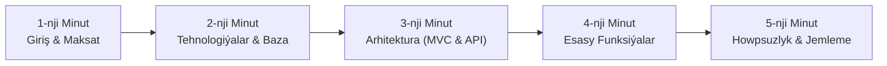
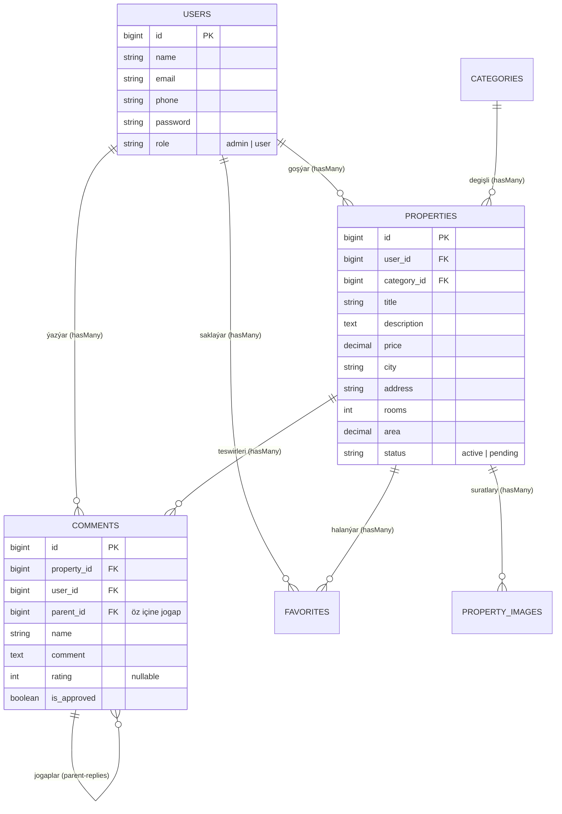

# EmläkGO Backend — Exam üçin Doly Gollanma we 5 Minutlyk Çykyş Meýilnamasy

Bu gollanma **EmläkGO** taslamasynyň backend bölegini mugallyma 5 minudyň içinde gysga, ynamly we gaty düşnükli edip gürrüň bermek üçin ýörite taýýarlandy.

---

## 1. 5 Minutlyk Çykyş Üçin Taýyn Ssenariý (Exam Plany)

> [!TIP]
> Çykyş eden wagtyňyz gysga we ynamly sözläň. Şulary yzygiderli aýtsaňyz, 5 minudyň içinde backend-iň ähli wajyp taraplaryny doly açyp berersiňiz.

### 0:00 - 1:00 | Giriş we Taslamanyň Maksady
> *"Salam hormatly mugallym! Men şu gün 'EmläkGO' atly Türkmenistanyň gozgalmaýan emläk platformasynyň backend böleginiň nähili gurlanlygy barada gürrüň berjek.*  
> *Bu taslamanyň esasy maksady — jaý satyjylar bilen alyjylaryň arasynda dellalsyz, amatly we howpsuz köpri döretmek. Backend-iň esasy wezipesi bolsa: ulanyjylaryň hasabyny ýöretmek, emläk maglumatlaryny howpsuz saklamak, çalt gözleg we süzgüç (filter) algoritmini üpjün etmek hem-de teswirler arkaly aragatnaşygy ýola goýmakdan ybaratdyr."*

### 1:00 - 2:00 | Tehnologiýalar we Maglumat Bazasy (Database)
> *"Taslamanyň backend-inde döwrebap we ygtybarly gurallary ulandyk:*
> - *Programmirleme dili: **PHP 8.4+***
> - *Freýmwork: **Laravel 13*** *(çalt, amatly we güýçli ORM arhitekturasy üçin)*
> - *Maglumat bazasy: **PostgreSQL*** *(ululy-kiçili gatnaşykly maglumatlary çalt we ygtybarly işlemek üçin)*
>
> *Maglumat bazamyzda 6 sany esasy tablisany biri-birine bagladyk:*
> 1. `users` — ulanyjylar we adminler.
> 2. `categories` — emläk görnüşleri (Kwartira, Jaý, Ofis, Ýer, Kireýine).
> 3. `properties` — ähli bildirişler (bahasy, şäheri, otag sany, ölçegi).
> 4. `property_images` — bir emläge degişli birnäçe suratlary saklaýan tablisa.
> 5. `comments` — teswirler we jogaplar (replies).
> 6. `favorites` — ulanyjylaryň halan emläkleri."*

### 2:00 - 3:00 | Arhitektura: "Çaga düşündirilen ýaly" MVC & REST API
> *"Backend-i **MVC (Model - View - Controller)** we **RESTful API** arhitekturasynda gurdyk. Muny bir restoranyň işleýşine meňzedip bolar:*
> - **Routes (Web/Api marşrutlar)** — bu restoranyň menyusy. Frontend näme soraýandygyny şu ýerden bilýär.
> - **Controllers (Dolandyryjylar)** — bu ofisiant. Frontend-den gelen talaby alýar, barlap aşhana ugradýar we netijäni yzyna JSON formatda eltip berýär.
> - **Models & Eloquent ORM** — bu aşpez we aşhana. Baza bilen göni aragatnaşyk gurup, maglumaty taýýarlaýar.
> - **PostgreSQL** — bu önümleriň saklanýan ammarlary.
>
> *Frontend bilen backend arasynda maglumatlar arassa **JSON** formatynda alyş-çalyş edilýär."*

### 3:00 - 4:00 | Esasy Aýratynlyklar we Funksionallar
> *"Backend-de durmuşa geçiren iň esasy funksionallarymyz:*
> 1. **Dinamiki Filtr we Gözleg:** Ulanyjy şäher, kategoriýa, otag sany we baha aralygy boýunça süzgüç ulananda, backend SQL `WHERE` şertlerini dinamiki düzüp, iň laýyk netijeleri çalt gaýtarýar.
> 2. **Köp Suratly Ýükleme (Multi-image upload):** Bir bildirişe birnäçe surat ýükläp bolýar. Backend suratlary serwerde ýerleşdirip, baglanyşygyny `property_images` tablisasynda saklaýar.
> 3. **Şahalanan Teswirler (Nested Replies):** Ulanyjylar diňe bir teswir ýazman, eýsem başga biriniň teswirine aşagyndan jogap (`reply`) berip bilýärler. Muny `parent_id` baglanyşygy arkaly gurdyk.
> 4. **Halananlar (Favorites) Ulgamy:** Ulanyjy islän jaýyny bir basyşda halananlara goşup ýa-da aýyryp bilýär (`toggleFavorite`)."*

### 4:00 - 5:00 | Howpsuzlyk, Rollar we Jemleme
> *"Howpsuzlyk babatynda:*
> - *Ulanyjy parollary **Bcrypt** kriptografiki heşleme arkaly gizlenýär.*
> - *Token esasynda autentifikasiýa ulanylýar — her bir amaly diňe ygtyýary bolan ulanyjy ýerine ýetirip bilýär.*
> - *Rollaryň aýratynlygy: Sistemada **Admin** we **Adaty Ulanyjy** bar. Adaty ulanyjy diňe öz goşan emläklerini we öz emläklerine gelen teswirleri dolandyryp bilýär, beýlekileriňkini bozup bilmeýär.*
>
> *Netijede, biz tiz işleýän, howpsuz, massştabirlenýän we häzirki zaman standartlaryna doly laýyk gelýän güýçli backend ulgamyny döretdik. Üns bereniňiz üçin köp sag boluň! Soraglaryňyz bolsa, jogap bermäge taýyn."*

---

## 2. Backend Arhitekturasynyň Şemasy

---

## 3. Mugallymyň Iň Köp Beräýmeli Soraglary we Taýyn Jogaplar

Mugallymlar köplenç jikme-jik kody soraman, **logikany** barlamak üçin şeýle soraglary berýärler:

### 1-nji Sorag: *"Frontend bilen Backend nädip gepleşýär?"*
> **Jogap:**  
> *"Olar **RESTful API** arkaly aragatnaşyk saklaýar. Frontend (Vue.js) HTTP haýyşlaryny (`GET`, `POST`, `PUT`, `DELETE`) ugradýar. Laravel controller-leri bu haýyşlary işläp, jogaby diňe standart **JSON** formatynda yzyna berýär."*

### 2-nji Sorag: *"Parollary nädip sakladyňyz? Açyk görnüşde dälmikä?"*
> **Jogap:**  
> *"Ýok, parollar hiç wagt açyk saklanmaýar. Laravel-iň `Hash::make()` funksiýasy arkaly **Bcrypt** heşleme algoritmi ulanylýar. Şol sebäpli hatda bazanyň içine giren adam hem parollary görüp ýa-da döwüp bilmeýär."*

### 3-nji Sorag: *"Suratlary bazada BLOB edip sakladyňyzmy ýa-da faýl görnüşinde?"*
> **Jogap:**  
> *"Suratlary göni bazada saklamadyk, sebäbi ol bazany agraldýar we haýalladýar. Suratlary serweriň `storage/app/public/properties` papkasynda faýl hökmünde sakladyk. Maglumat bazasyndaky `property_images` tablisasynda bolsa diňe şol suratyň ady we ýoly (`image_path`) ýazylýar."*

### 4-nji Sorag: *"Bir teswire jogap (reply) bermek logikasyny nähili etdiňiz?"*
> **Jogap:**  
> *"Biz aýratyn täze tablisa açmadyk. `comments` tablisasyna `parent_id` diýen sütüni goşduk. Eger teswir asyl teswir bolsa, onuň `parent_id`-si `NULL` bolýar. Eger başga teswire jogap bolsa, şol esasy teswiriň `id`-sini `parent_id` edip belleýäris. Şeýlelikde bir tablisanyň içinde çäksiz şahalanýan jogap agajy emele gelýär."*

### 5-nji Sorag: *"Adaty ulanyjy başga biriniň emlägini ýa-da teswirini pozup bilýärmi?"*
> **Jogap:**  
> *"Ýok, pozup bilmeýär. Controller-lerde `auth()->id() === $property->user_id` barlagy goýuldy. Eger ulanyjy admin däl bolsa, ol diňe özüne degişli zatlary dolandyryp bilýär. Başga biriniň zadyna el urjak bolsa, serwer `403 Forbidden` ýalňyşlygyny berýär."*

---

## 4. Çykyşda Üstünlik Gazanmagyň Maslahatlary

1. **Parahat we düşnükli gürläň:** Düşnüksiz terminleri köp ulanman, zatlaryň näme üçin şeýle edilendigini aýdyň.
2. **Sorag berse gorkmaň:** Mugallym sorag berse, meseläni çözüp bilendigiňizi we gurluşyna düşünýändigiňizi görkeziň.
3. **5 minutlyk wagty goraň:** 1-nji bölümden başlap 5-nji bölüme çenli her bölüme takmynan 1 minut sarp ediň.
